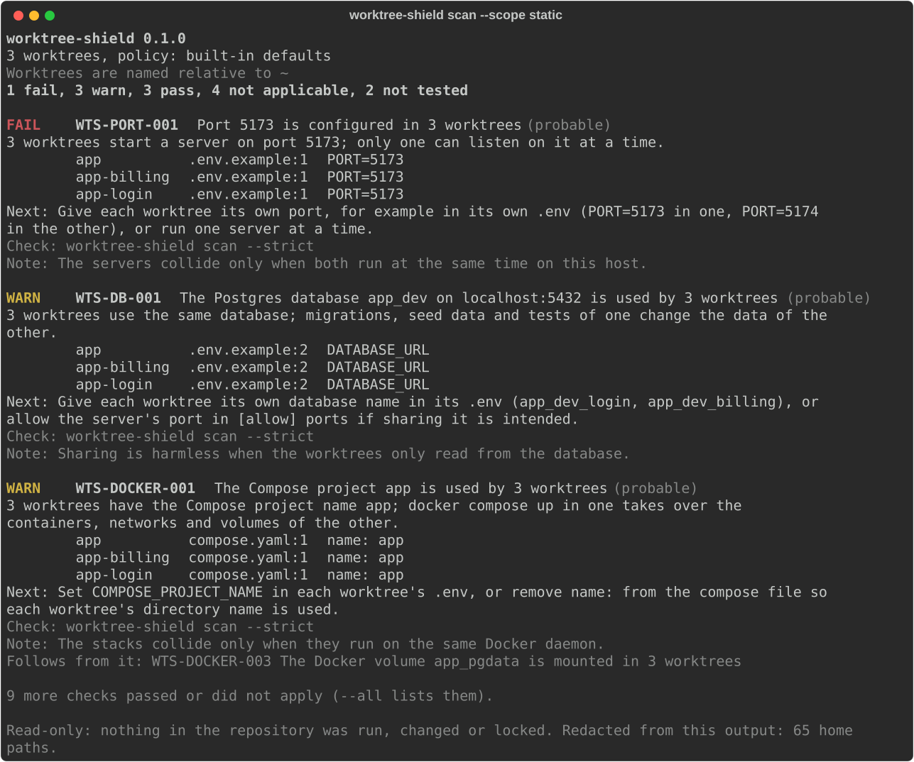

# Worktree Shield

**Audit parallel Git worktrees for shared ports, databases and Docker resources before your agents collide.**

[](https://github.com/BhuwanJoshi-01/worktree-shield/actions/workflows/ci.yml)
[](https://github.com/BhuwanJoshi-01/worktree-shield/blob/main/LICENSE)
[](https://bhuwanjoshi-01.github.io/worktree-shield/)

> **Status:** 0.1.0 is the first release. It is tested on Linux and Windows; reports from macOS and from your own
> worktree setups are very welcome. See the [roadmap](https://github.com/BhuwanJoshi-01/worktree-shield/blob/main/docs/roadmap.md).

Git worktrees give every agent or task its own checkout, but not its own infrastructure. Three worktrees can still
start a dev server on the same port, migrate the same `app_dev` database, reuse one Docker Compose project name or
write to the same absolute folder:

```text
repo-main/              API -> :8000     DB -> postgres://localhost/app_dev
repo-feature-login/     API -> :8000     DB -> postgres://localhost/app_dev
repo-feature-billing/   API -> :8001     DB -> postgres://localhost/app_dev
```

Worktree Shield finds these shared resources in worktrees that **already exist**, however they were created
(plain `git worktree`, a worktree manager or a coding agent), and reports each one with the file and line it came
from and how certain the collision is.

## Install

Needs Python 3.11 or newer and Git.

```bash
uv tool install git+https://github.com/BhuwanJoshi-01/worktree-shield   # until the PyPI release
pipx install git+https://github.com/BhuwanJoshi-01/worktree-shield      # or with pipx
```

## Use

```bash
worktree-shield scan                 # all worktrees of the current repository, read-only
worktree-shield scan --strict        # exit 1 when a finding fails under the policy, for CI and agent preflight
worktree-shield scan --scope static  # configuration only; leave running processes alone
worktree-shield plan                 # one change per worktree that would resolve it; never applied
worktree-shield explain WTS-PORT-001 # what a finding means and how to fix it
worktree-shield policy               # the policy in .worktree-shield.toml, checked, or the defaults
worktree-shield resources            # every port, database, Compose name and path each worktree declares
worktree-shield report --format sarif --output conflicts.sarif   # also markdown, json
worktree-shield scan --strict --format json                      # for agents and scripts
```



Try it on a repository built to collide:

```bash
python examples/conflicting-worktrees/build.py /tmp/wts-demo
worktree-shield scan --repo /tmp/wts-demo/app --scope static
```

## In CI

A CI checkout is a single worktree, so the GitHub Action checks this branch out next to another ref, as a second
worktree, and reports what the two would share:

```yaml
jobs:
  worktree-shield:
    runs-on: ubuntu-latest
    permissions:
      contents: read
      security-events: write   # for upload-sarif
    steps:
      - uses: actions/checkout@v7
      - uses: BhuwanJoshi-01/worktree-shield@v0.1.0
        with:
          compare-with: main     # refs to check out next to this branch
          strict: "true"         # fail when a finding fails under .worktree-shield.toml
      - uses: github/codeql-action/upload-sarif@v4
        if: always()             # upload the report even when the scan failed the job
        with:
          sarif_file: worktree-shield.sarif
```

The scan in CI is static: running processes on a runner say nothing about your machine.

## What it promises

- **Read-only.** It never writes to your worktrees or `.git`, never prunes, kills, starts containers or touches
  databases.
- **Nothing from the repository runs.** Config files are parsed as data; package scripts, Git hooks, Vite configs
  and Compose are never executed. Docker doesn't need to be running.
- **No secrets in output.** Database URLs are reduced to host, port and database name as soon as they are read.
  `.env` files are only read when you opt in.
- **Honest certainty.** Two worktrees declaring the same port is a *probable* collision; it is *confirmed* only when
  a running process proves it. Intentionally shared infrastructure (one Postgres for everyone) can be allowed by
  policy.
- No network access, no telemetry.

## Alternatives

Worktree managers can avoid collisions when they create the worktrees:
[workz](https://github.com/rohansx/workz) allocates ports, database names and Compose project names, and
[worktree-compose](https://github.com/mostafasudo/worktree-compose) checks port collisions between the worktrees it
manages with `wtc doctor`. Worktree Shield doesn't create anything; it audits whatever is already there, with a
policy file, CI exit codes and SARIF.

## Documentation

- [Command reference](https://github.com/BhuwanJoshi-01/worktree-shield/blob/main/docs/cli.md) and exit codes
- [Rules](https://github.com/BhuwanJoshi-01/worktree-shield/blob/main/docs/rules.md): every finding ID, what decides its status, how to fix it
- [Policy file](https://github.com/BhuwanJoshi-01/worktree-shield/blob/main/docs/policy.md): `.worktree-shield.toml`
- [What is read](https://github.com/BhuwanJoshi-01/worktree-shield/blob/main/docs/what-is-read.md), and what never is
- [JSON, SARIF and Markdown output](https://github.com/BhuwanJoshi-01/worktree-shield/blob/main/docs/json-output.md), with [sample reports](https://github.com/BhuwanJoshi-01/worktree-shield/tree/main/docs/sample-reports)
- [Architecture](https://github.com/BhuwanJoshi-01/worktree-shield/blob/main/docs/architecture.md), [privacy](https://github.com/BhuwanJoshi-01/worktree-shield/blob/main/docs/privacy.md), [troubleshooting](https://github.com/BhuwanJoshi-01/worktree-shield/blob/main/docs/troubleshooting.md)

## License

[MIT](https://github.com/BhuwanJoshi-01/worktree-shield/blob/main/LICENSE)
