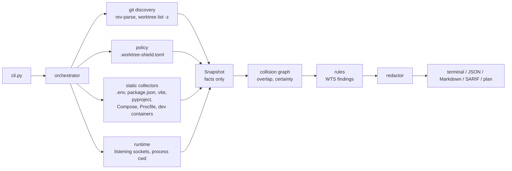

# Architecture

worktree-shield is a pipeline of plain functions. Every stage hands a frozen value to the next, and only the first
stage reads from the system.

## Stages

1. **Discovery** (`git/`). git runs with optional locks off, no terminal prompt and no fsmonitor, so it reads
   `.git` without writing to it. `worktree list --porcelain -z` is the stable, NUL-separated format, safe for paths
   with spaces or newlines.
2. **Policy** (`config.py`). The current worktree's `.worktree-shield.toml` is read as TOML data, with every key
   checked. Flags take precedence over the file, and the file over the defaults.
3. **Collectors** (`collectors/`). These find the directories worth reading (`layout.py`) and read each known file
   through `files.read_inside()`, which:
   - stays inside the worktree;
   - opens regular files only;
   - enforces the size cap.

   Pure parsers (`parsers/`) turn the text into claims: dotenv, database URLs, command lines, JavaScript with its
   literals blanked out, Compose interpolation and the Compose port and volume syntax. The runtime collector reads
   the listening sockets and each owner's name and working directory, and nothing else.
4. **Snapshot** (`models.py`). The snapshot holds the repository, the policy, every claim, the files that were
   skipped, the values that could not be identified, and the runtime view. It records facts only: no conclusion
   is drawn at this stage.
5. **Collisions** (`overlap.py`, `collisions.py`). Keys of one kind are joined when they overlap (wildcard
   addresses, loopback database servers, nested paths). Claims by more than one worktree become a collision that
   is *confirmed*, *probable* or *possible*.
6. **Rules** (`rules/`). Each rule turns collisions or context into findings. `status_for()` combines the policy
   level and the certainty; that is the only place they meet.
7. **Output** (`reports/`, `plan.py`). Every renderer receives a redacted snapshot. The terminal output uses plain
   `Text` and never Rich markup, so collected text cannot style the output. JSON follows a versioned schema.

## The resource model

| Kind | Key | Collides when |
| --- | --- | --- |
| `listen_port` | `tcp://*:5173`, `tcp://127.0.0.1:8000`, `udp://…` | Same protocol and port, overlapping addresses (`*`, `0.0.0.0`, `::` take every address). |
| `client_endpoint` | `tcp://localhost:5432` | Never. Many clients can share one server. |
| `database` | `db://postgres/localhost:5432/app_dev` | Same engine, server, port and database. `localhost`, `127.0.0.1` and `::1` are one server. |
| `compose_project` | `compose-project://app` | Equal names. |
| `container_name` | `container://shop-db` | Equal names. |
| `volume` | `volume://app_pgdata` | Equal names. |
| `absolute_path` | `path:///srv/uploads` | Equal after normalising, or one inside the other (possible). |

Listening ports and client endpoints are separate kinds from the collectors onwards. Because of that, allowing a
shared database server can never hide two servers that both bind one port.

## What is never done

- Nothing from the repository is executed: no scripts, hooks, Vite configs, Compose files, Python or shell.
- Nothing is written, `.git` included. The one exception is `report --output FILE`, which writes that file.
- No process is signalled, Docker is not contacted, and nothing goes over the network.
- No secret is kept. Values of variables that no rule needs are dropped right after parsing, and database URLs
  lose their credentials while they are parsed.
